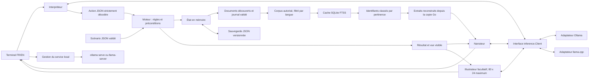

# Architecture du prototype

La définition du scénario est immuable. L'état courant appartient au moteur Go. Le modèle n'a aucun accès aux méthodes de mutation : son JSON est une proposition non fiable.

## Packages et structures

- `world.Definition` : version, identifiant, lieux, objets, drapeaux initiaux, règles d'utilisation et objectif. Un `Exit` possède une destination et des `Condition`. Un `UseRule` décrit outil, cible, lieu, conditions, effets booléens et message factuel.
- `engine.State` : lieu courant, nombre d'actions de mutation réussies, position unique de chaque objet, drapeaux, identifiants documentaires découverts et journal borné de 128 événements typés. La position réservée `@inventory` représente l'inventaire ; il n'y a pas deux collections à synchroniser.
- `engine.Action` : `action`, `target`, `tool`. Actions autorisées : `observe`, `move`, `take`, `drop`, `use`, `inventory`, `unknown`. Déplacement par direction ; objets par identifiant stable. Pour `use`, `tool` est obligatoire et `target` peut être vide pour une utilisation autonome.
- `engine.Engine` : conserve des copies privées du scénario et de l'état. `Apply(Action) (Result, error)` vérifie la forme, la visibilité, la portabilité, les possessions et les préconditions ; applique sur une copie ; valide les invariants ; puis effectue le remplacement. `Snapshot` et `View` renvoient des copies.
- `inference.Client` : `Complete(context.Context, Request) (string, error)`. `Request` contient les messages, le JSON Schema, la température et le budget de sortie ; aucune notion d'API Ollama n'entre dans le moteur.
- `language.Interpreter` : `Interpret(context.Context, string, engine.View) (engine.Action, error)`. `language.Narrator` : `Narrate(context.Context, engine.Result) (string, error)`.
- `illustration.Illustrator` : `Illustrate(context.Context, engine.View) (Frame, error)`. Son adaptateur LLM projette uniquement le décor visible, sans inventaire ni mémoire RAG. `Frame` contient 1 à 24 lignes ASCII imprimables de 80 colonnes au maximum, avec une palette fermée. Le JSON et les dimensions sont revalidés en Go ; le terminal génère lui-même l'ANSI et refuse un dessin invalide avant toute ligne affichée.
- `ollama.Client` : HTTP `/api/chat`, sans streaming, contexte annulable, délai et taille bornés ; sonde `/api/tags` pour vérifier le modèle.
- `llamacpp.Client` : HTTP `/v1/chat/completions`, schéma dans `response_format.json_schema.schema`, sonde `/health`, vérification de l'alias par `/v1/models` et du chemin chargé par `/props` lorsque `-gguf` est fourni. Le nom par défaut vient du fichier GGUF ; `OLLAMA_MODEL` ne concerne que le fournisseur Ollama. Un serveur existant avec un autre alias ou fichier est refusé sans être arrêté.
- `inference/httpjson` : transport borné partagé par les adaptateurs, avec annulation et refus des redirections.
- `modelruntime.Service` : supervision séparée de l'inférence. `Ensure(ctx, Config)` réutilise ou démarre un service, attend sa disponibilité et renvoie sa propriété via `Owned()`. `Close()` est idempotent et ne touche qu'au processus lancé par le jeu.
- `persistence` : enveloppe versionnée, identifiant et SHA-256 du scénario, état. Lecture bornée, validation complète et remplacement atomique du fichier.
- `terminal` : commandes système locales, orchestration de l'interprétation, de la narration et de l'illustration facultative, faits canoniques toujours affichés et repli en cas d'erreur. `Printer` applique une palette ANSI après traduction et filtrage des contrôles. Le mode automatique détecte le terminal et respecte `NO_COLOR` et `TERM=dumb` ; les sorties redirigées restent sans couleur, sauf choix explicite `-color always`.

## Langue de la partie

`-lang en|fr` configure une valeur `locale.Language` explicite, sans variable globale mutable. `scenarios.Demo` charge la variante embarquée correspondante ; `engine.NewWithLanguage` produit les messages factuels dans cette langue. Les règles et le format des actions restent identiques. `language.LLM` sélectionne ses prompts et `language.Offline` sa grammaire. Le terminal traduit uniquement ses formats de messages, jamais les données interpolées.

Les erreurs applicatives utilisent `locale.Errorf` pour conserver un format traduisible et leurs causes (`errors.Is`/`errors.As`). Elles sont rendues dans la langue choisie à la frontière du terminal. Les diagnostics externes (OS, serveur) sont conservés.

Les variantes de démonstration ont des identifiants et empreintes distincts, donc des sauvegardes séparées (`savegame-en.json` / `savegame-fr.json`). La langue est choisie au démarrage ; il n'y a pas de conversion de sauvegarde entre variantes. Un scénario externe conserve ses textes. Un futur générateur devra produire ses textes et ses identifiants dans la langue demandée avant la validation commune.

## Un tour de jeu

1. Le terminal intercepte `help`, `save`, `load`, `quit` (également avec `/`) et leurs équivalents français quand `-lang fr` est choisi. Les directions exactes affichées sont aussi des raccourcis natifs validés par le moteur ; les déplacements en langage naturel passent par le LLM. Le chemin de sauvegarde est une option CLI, jamais une sortie du modèle.
2. L'interpréteur reçoit la phrase et une vue limitée au lieu courant, aux sorties, aux objets présents et à l'inventaire. Le schéma exige exactement trois chaînes et une action connue. Le décodage Go refuse les champs inconnus, doublons, valeurs nulles, clés manquantes et documents supplémentaires.
3. Le moteur revalide cette proposition, même si elle vient du parseur hors ligne. Une action impossible laisse l'état intact. Observation et inventaire ne consomment pas de tour.
4. Le terminal affiche le résultat canonique. Le narrateur reçoit ce résultat, la nouvelle vue et, si le RAG est actif, quelques extraits documentaires approuvés, puis produit un court texte dans la langue choisie. Le texte n'est jamais réinterprété comme une commande et n'entre pas dans les sauvegardes.
5. Si l'interprétation échoue, aucune action n'est appliquée. Si la narration échoue, l'action validée reste acquise et les faits Go restent lisibles. Les commandes `/...` permettent de continuer sans inférence.

Un schéma JSON ne garantit pas la vérité sémantique d'une narration. Les consignes limitent les inventions, mais seuls les faits du moteur font foi ; ils sont affichés séparément. Le prototype est mono-joueur et séquentiel, sans garantie d'accès concurrent au même moteur.

L'option `-art` ajoute un appel distinct au démarrage et sur déplacement/observation globale. Les dessins valides sont mis en cache par lieu et signature du décor public, avec un maximum de 64 lieux et une invalidation au chargement. Une commande `/` peut réafficher un cache à jour mais ne génère jamais de dessin. `art` / `dessin` est une commande de présentation sans tour ni mutation. Le rendu reste décoratif, non sauvegardé et hors du RAG ; une erreur conserve les descriptions canoniques. `-no-narration` désactive seulement la prose ; l'illustration est facultative et indépendante.

## Recherche documentaire

`world.Document` définit un texte et ses conditions de découverte. `Engine` apprend les documents accessibles au démarrage et après une action réussie. Le journal conserve uniquement action, tour et lieu : les phrases historiques sont reconstruites depuis le scénario, jamais depuis une réponse LLM. `Engine.Memory()` renvoie des copies des connaissances autorisées dans la langue choisie, sans exposer les conditions ni les drapeaux privés.

`language.RAGNarrator` implémente l'interface `Narrator` existante. Il fournit à `retrieval.Searcher.Search` une empreinte de scénario, la langue, la requête issue du résultat canonique et le corpus autorisé complet. L'adaptateur `retrieval/sqlite` remplace le corpus concerné et effectue la recherche dans une seule transaction. FTS5 utilise `unicode61 remove_diacritics 2` et BM25. La requête est reconstruite à partir de termes littéraux bornés, avec paramètres SQL ; aucune instruction SQL ou expression FTS libre du joueur n'est exécutée.

La sélection est bornée à trois extraits et 1 600 caractères Unicode de titres et textes. Le narrateur retrouve chaque identifiant retourné dans la copie Go et reconstruit lui-même le texte à envoyer : le cache ne peut pas devenir l'autorité sur le contenu. Les événements sont étiquetés comme historiques ; le résultat et la vue actuelle priment. Les erreurs ou le dépassement du délai de recherche de deux secondes déclenchent un repli sans mémoire documentaire.

La base porte un identifiant d'application et une version de schéma. Un fichier SQLite étranger est refusé. Elle peut être reconstruite ou supprimée indépendamment des sauvegardes JSON. Le format de sauvegarde v2 stocke les découvertes et le journal dans `State`, donc un chargement restaure aussi la branche narrative. La recherche suivante remplace les lignes périmées de l'index, même avec un corpus vide. Les snapshots v1 sont compatibles si le scénario de base n'a pas changé ; l'ancienne empreinte est vérifiée en omettant uniquement le nouveau champ `documents`.

L'interpréteur et les règles ne dépendent pas du RAG. Aucun embedding n'est utilisé dans cette version ; une autre implémentation de `Searcher` pourra ajouter une recherche sémantique tout en conservant les limites de visibilité et de contexte.

## Cycle de vie de l'inférence

Le lancement du jeu compose l'adaptateur et le superviseur. L'interface `inference.Client` reste indépendante de la gestion des processus ; le moteur ne connaît ni l'un ni l'autre.

1. Sonder le service avec un délai borné. S'il est prêt et propose le modèle demandé, le réutiliser sans en prendre possession.
2. Si le service répond mais charge encore le modèle, attendre. Une erreur de protocole, un modèle absent ou un problème d'authentification ne provoque aucun lancement supplémentaire.
3. Uniquement si la connexion est refusée et `-auto-start=true`, construire la commande locale. Refuser le lancement sur une URL distante, HTTPS ou avec préfixe de chemin.
4. Lancer sans shell, conserver un journal circulaire de 8 Kio et attendre la disponibilité dans la limite de `-startup-timeout`. Les tentatives individuelles de sonde ont un délai maximal de deux secondes, également borné par les délais HTTP et global.
5. En cas d'échec du démarrage, arrêter et attendre le processus possédé. Un exécutable absent ou un GGUF invalide produit un diagnostic avant l'entrée dans la partie.
6. Pendant la partie, conserver le processus. Pour Ollama lancé par le jeu, `OLLAMA_KEEP_ALIVE=-1` conserve le modèle chargé après son premier appel ; un service réutilisé garde sa politique habituelle. Le chargement initial Ollama se produit au premier appel et relève du délai `-timeout`, tandis que `/health` de llama.cpp attend déjà le chargement du GGUF.
7. À la sortie ou à l'annulation, envoyer SIGTERM au groupe privé sous macOS/Linux, puis SIGKILL après trois secondes si nécessaire. `Wait` collecte le processus et un nettoyage du groupe traite les descendants restants. Les autres plateformes utilisent l'arrêt direct du processus enfant ; l'équivalent Windows par Job Objects reste à ajouter. Un arrêt brutal du programme par SIGKILL ne permet pas ce nettoyage.

Les exécutables et les poids restent des fichiers distincts du binaire Go. Aucun modèle n'est téléchargé automatiquement. `llama-server` est lancé avec un modèle local, `--offline`, un seul slot et les options explicites du jeu. Les variables de configuration `LLAMA_*` du parent ne sont pas héritées par ce processus privé, pour éviter qu'une configuration externe ne change le modèle, l'authentification ou les fonctionnalités du serveur ; les variables générales CPU/GPU restent disponibles. Pour des réglages avancés, lancer le serveur séparément puis utiliser `-auto-start=false`.

## Préparer la génération procédurale

`world.Source` abstrait le chargement d'une définition ; les sources fichier et embarquée passent toutes par `world.Validate`. Un futur générateur pourra implémenter cette interface, avec graine et provenance dans la définition. Les règles sont des données déclaratives, sans code exécutable.

La validation vérifie références, identifiants, drapeaux, unicité des règles et connexité dirigée depuis le départ en ignorant les verrous. Elle ne prouve pas encore la résolubilité des énigmes : un futur générateur devra ajouter un solveur borné et des tests par graine avant de rendre son résultat jouable. La sauvegarde conserve l'empreinte de toute la définition ; un scénario généré devra donc être conservé avec sa sauvegarde. La migration v1 vers v2 des sauvegardes est prise en charge ; l'embarquement des scénarios générés reste à implémenter.
